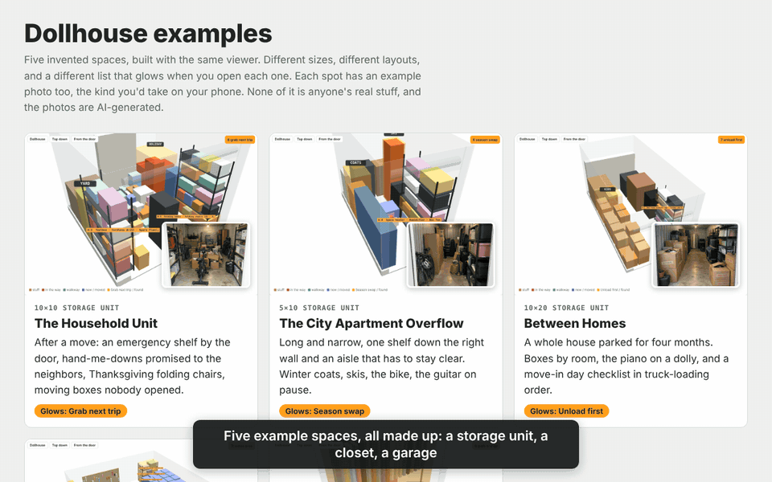

# Dollhouse

A clickable 3D map of a storage unit, closet, garage or basement, showing what's on every shelf. It's for the things that matter but you don't need every day: the emergency kit, the baby gear you promised the neighbors, the folding chairs that come out once a year, the tax records. You build it by talking through the space with an AI. No tape measure, no floor-plan app.

**Try it in your browser:** [ssskay.github.io/dollhouse](https://ssskay.github.io/dollhouse/)



- **Find anything.** Type part of a name and the shelf it's on lights up.
- **Grab next trip.** Mark things you need soon and their shelves glow when you open it, so a trip to the unit is a grab instead of a dig. The glowing list is configurable (a reseller can make it "sold, not shipped").
- **Read a shelf.** Tap a shelving unit and the camera turns to face it, with every level labelled (A-1 is the top shelf).
- **Where does it go?** House rules map each kind of thing to one spot, so putting things away is a lookup instead of a decision.
- **Now / Plan.** See what's in the way today (the exercise bike by the door, the moving boxes nobody opened), and the walkway once you've cleared it.
- **Steps.** An optional checklist for a build or clear-out day, saved in your browser.

It's a single page that opens with a double-click and works offline. Your data stays in two plain files in your own folder.

## Try it

Open `index.html` for the five examples. Each is an invented space with its own layout and its own glowing list:

| example | the space | what glows |
|---|---|---|
| [The Household Unit](spaces/1-household-10x10/index.html) | 10×10 storage unit after a move: emergency shelf by the door, hand-me-downs promised to the neighbors, hosting gear, holiday bins, moving boxes nobody opened | Grab next trip |
| [The City Apartment Overflow](spaces/2-city-5x10/index.html) | 5×10, long and narrow: one shelf down the wall, an aisle that has to stay clear, winter coats, skis, the bike | Season swap |
| [Between Homes](spaces/3-between-homes-10x20/index.html) | 10×20 holding a whole house for four months: boxes by room, the piano on a dolly, a move-in checklist in truck-loading order | Unload first |
| [The Two-Car Garage](spaces/4-two-car-garage/index.html) | one car parked, one bay full of stuff, a pegboard, an overhead rack above the car, storm panels labelled by window | Storm prep |
| [The Hall Closet](spaces/5-hall-closet/index.html) | five feet wide: guest bedding up high, coats on the rod, the go-bag on the floor | Grab and go |

Everything in them is made up, and so are the photos (generated, see `docs/PHOTOS.md`). In the household example, type "neighbors" in the find box and the bins promised to them light up.

### What it's good for

The things that matter but you don't need every day:

- **Emergency and storm supplies:** go-bags, first aid, flashlights, water, a weather radio, the generator, storm panels.
- **Promised to someone:** baby clothes, a bassinet, the car seat (check its expiry sticker), the stroller, each bin labelled with who it's for.
- **Once-a-year hosting:** folding tables and chairs, the air mattress, the big roasting pan.
- **Just in case:** crutches, spare floor tiles, paint labelled by room, appliance manuals and warranties.
- **Seasonal swaps:** winter coats and skis out, the box fan and beach towels in.
- **Keepsakes:** photo albums, yearbooks, the wedding dress, Grandma's china.
- **On pause:** the guitar, the golf clubs, the exercise bike.
- **Between homes:** a whole house in boxes, and which ones you need the first night.

## Make your own

1. Copy `spaces/_template` to `spaces/<your-space>`.
2. Give an AI assistant `intake/SKILL.md` (it's a Claude skill, and works pasted into any chat) and describe your space. A walk-through video from your phone helps a lot. It writes `space.js` and `items.csv` for you.
3. Turn the CSV into the file the page reads, and check for mistakes:
   ```
   python3 tools/csv_to_items.py spaces/<your-space>
   python3 tools/check.py spaces/<your-space>
   ```
4. Open `spaces/<your-space>/index.html`.

When something moves or leaves, tell the AI (or edit `items.csv`) and run step 3 again.

## The two files

### items.csv

| column | what it holds |
|---|---|
| `name` | what the thing is |
| `at` | where it is: a shelf level (`A-2`), a spot code (`HOLIDAY`), optionally a bin after a space (`B-2 LEGOBIN`) |
| `status` | free text. `grab` glows by default; `gone` is hidden |
| `note` | optional |

If you already keep an inventory spreadsheet with a location column, export it with these headers.

### space.js

Sets `window.DOLLHOUSE`. Sizes are in whatever unit you pick (feet in the demo). Stand in the doorway looking in: **x** runs left to right, **z** runs from the door wall (0) to the back wall.

| field | what it does |
|---|---|
| `title`, `subtitle`, `eyebrow` | page heading |
| `cover` | optional photo shown in Now, e.g. the view from the door |
| `room` | `width`, `depth`, `height`, `door: {from, to, hinge}` along the front wall (x from/to); add `type: "rollup"` for a storage-unit roll-up door |
| `now`, `plan` | `headline` and `summary` for each mode; `plan.walkways` is a list of floor boxes drawn as the path |
| `highlight` | `label` and `statuses` for the glowing mode (default `Grab next trip` / `grab`) |
| `hideStatuses` | statuses left off the map (default `gone`) |
| `spots` | everything in the room (below) |
| `rules` | `{thing, at, note, spot}`: kind of thing → where it goes |
| `steps` | `{title, note, spot}`: optional ordered checklist; `stepsLabel` / `stepsTitle` / `stepsSummary` name it |

Each spot:

| field | what it does |
|---|---|
| `id` | unique, used by rules and steps |
| `code` | short address (`A`, `HOLIDAY`). Shelving units need one so their levels can be addressed |
| `name`, `what`, `todo` | shown when you tap it (`todo` shows as the rule for that spot) |
| `kind` | `rack`, `shelf`, `boxes`, `bin`, `pile`, `wardrobe`, `panel`, `pegboard`, `chair`, `suitcase`, `car`, `floor`, or `block` |
| `box` | `[x0, z0, x1, z1]` footprint on the floor |
| `height`, `levels` | how tall; how many shelves (racks) |
| `elevation` | how high off the floor it's mounted: overhead racks, wall hooks, closet shelves above a coat rod |
| `photo` | optional image path, e.g. a still from your walk-through video |
| `plan` | `stay` (default), `gone`, `move` (with `moveTo: [x0, z0, x1, z1]`), or `new` (only drawn in Plan) |
| `blocking` | `true` tints it red in Now as something in the way |
| `color` | optional override |

## Folder layout

```
index.html         the gallery of examples
viewer/            the page itself (dollhouse.js, dollhouse.css, bundled three.js)
spaces/            one folder per space: index.html, space.js, items.csv, items.js, photos/
intake/SKILL.md    the interview an AI runs to build a space from your description
tools/             csv_to_items.py, check.py (python3, standard library; check.py also needs node)
```

The browser console logs what loaded and any item whose address doesn't match a spot.

## Credits

Made by [Sara Kay](https://sarakay.me). 3D by [three.js](https://threejs.org) (MIT, bundled in `viewer/vendor`). MIT licensed.
